# Awana Betania

A web app that runs the weekly club evenings of Awana Timișoara, a non-profit Christian children's club: attendance and points, leader planning, an end-of-season fair paid with NFC cards, and the yearly competition. It is in production and used by 100+ children and volunteer leaders.

> **About this repository**
> This is a showcase repo: it contains documentation only. The source code is private because the app runs in production with real data about children and volunteers. I'm happy to do a code walkthrough on request.

---

## The problem

The club meets once a week. Every evening, leaders recorded for each child whether they came, brought their Bible, said their lesson and earned extra points, on paper and later in spreadsheets. Season totals, streaks and rewards (manual, shirt, hat) were calculated by hand, and so were the end-of-season fair, where children spend their points on prizes, and the yearly competition scored by two independent referees.

That meant:
- totals that didn't match between sheets and nobody knew which one was right,
- long queues at the fair while someone looked up a child's balance and subtracted by hand,
- no clear view of which leader serves in which department on which evening,
- starting a new year meant starting a new file and losing easy access to the old one.

## What the app does

- **Club evenings and scoring** — per-child, per-meeting points (attendance, Bible, lesson, extra), daily and season totals, attendance streaks and reward eligibility.
- **Children and leaders registry** — profiles, attendance and points, handbooks and rewards, warnings and suspensions.
- **Departments and planning** — which leaders serve in which department each evening, with minimum/maximum staffing per department; team games with team points.
- **Leader evaluations and notifications** — feedback for leaders, notifications when a child becomes eligible for a reward.
- **End-of-season fair (NFC)** — a seller builds a receipt on a phone; the accountant taps the child's NFC card on a reader, the child's pending receipt appears, and approving it deducts the points.
- **Olimpiada** — the yearly competition: two referees score the same four teams independently per round (including referees without an account, who join with a short session code); a comparison view highlights where they disagree and shows the final ranking.
- **Seasons** — one season per club year. Starting a new season backs up the database, archives each child's results, and resets the season counters, while keeping children, leaders, accounts and cards. Past seasons stay readable.
- **Accounts and roles** — children sign up with a password; leaders are invited by the director and can sign in with Google. Access is enforced on the server per role (child, leader, director/coordinator, guest referee).

## Screenshots

All screenshots were taken on a local copy of the app with an empty database filled with invented demo data: no real children, leaders or contact details.

### Sign in
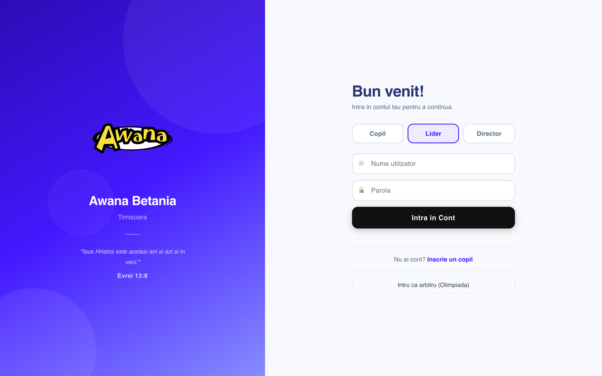

### Dashboard
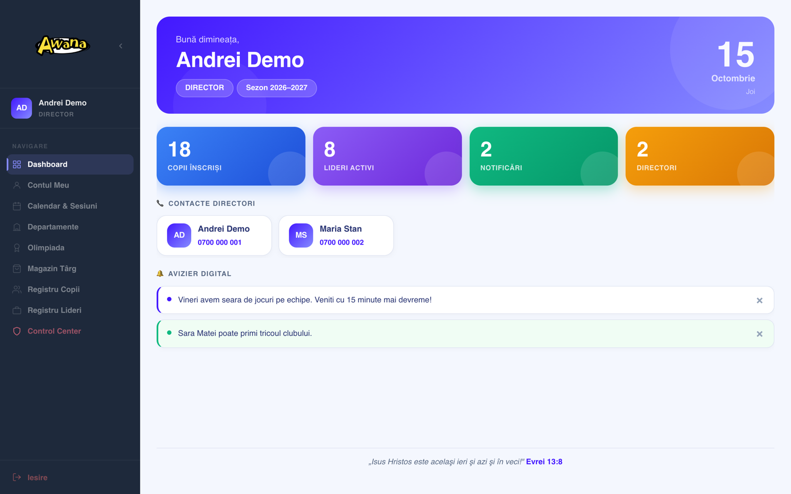

### Scoring an evening
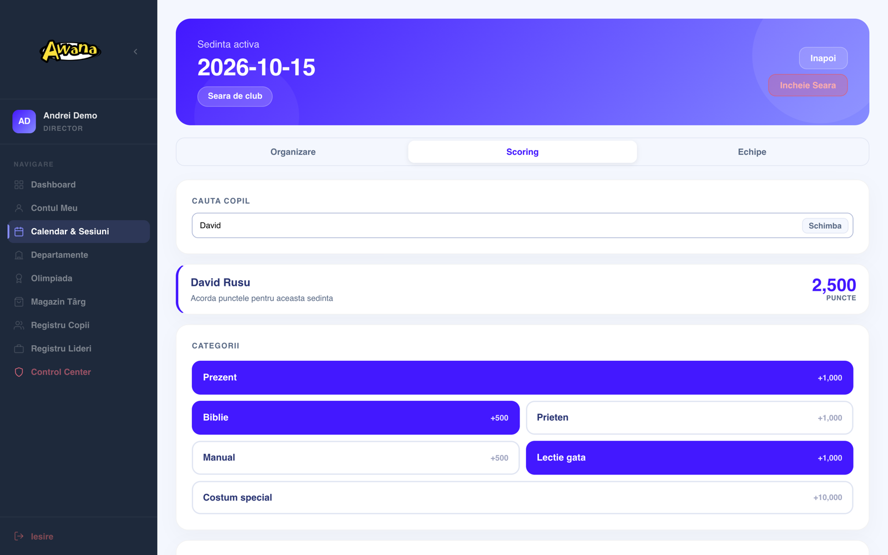

### Children registry and a child's profile
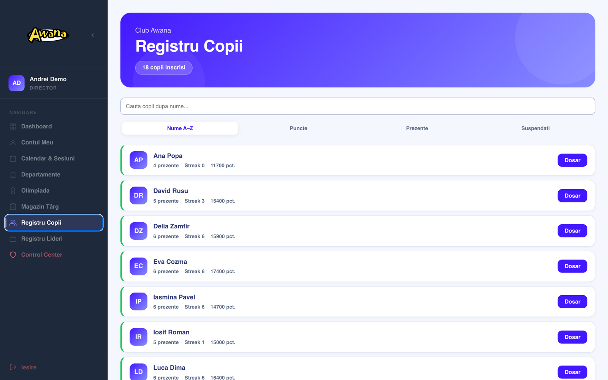
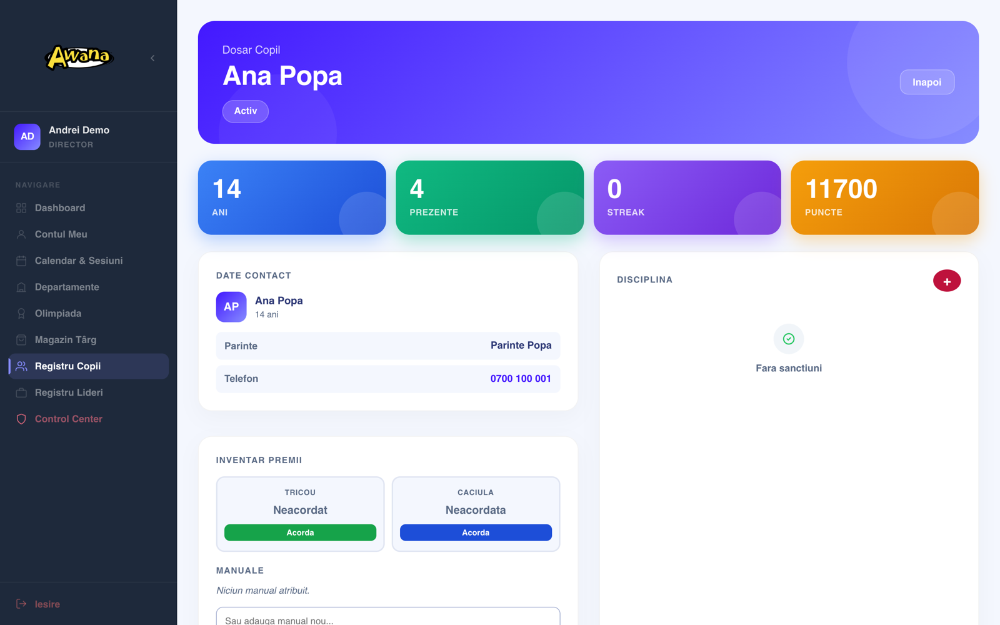

### Calendar and department planning for an evening
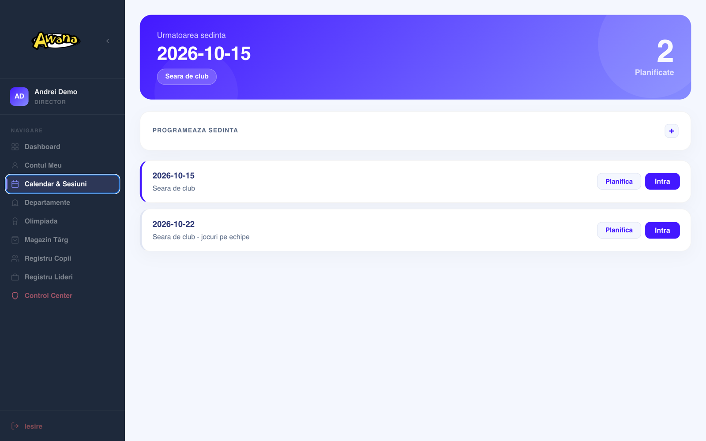
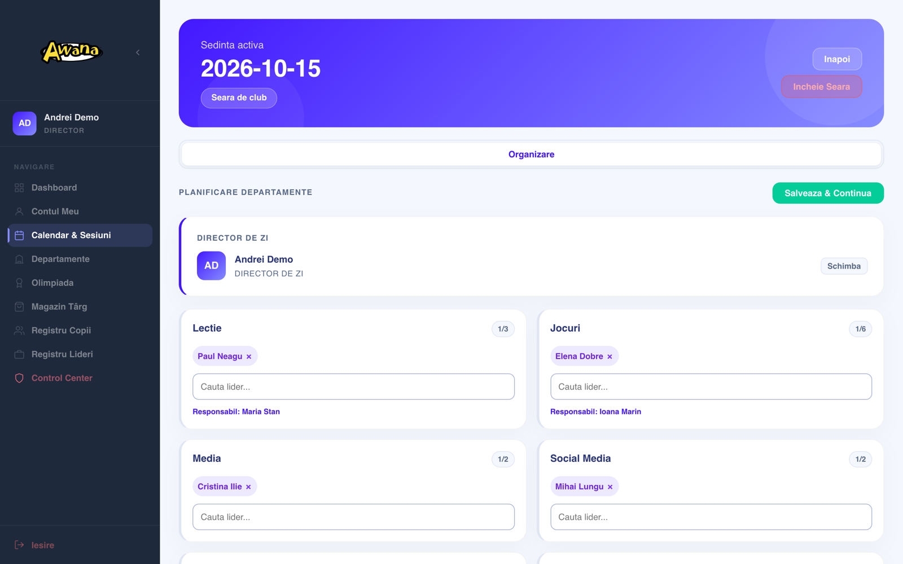

### What a child sees
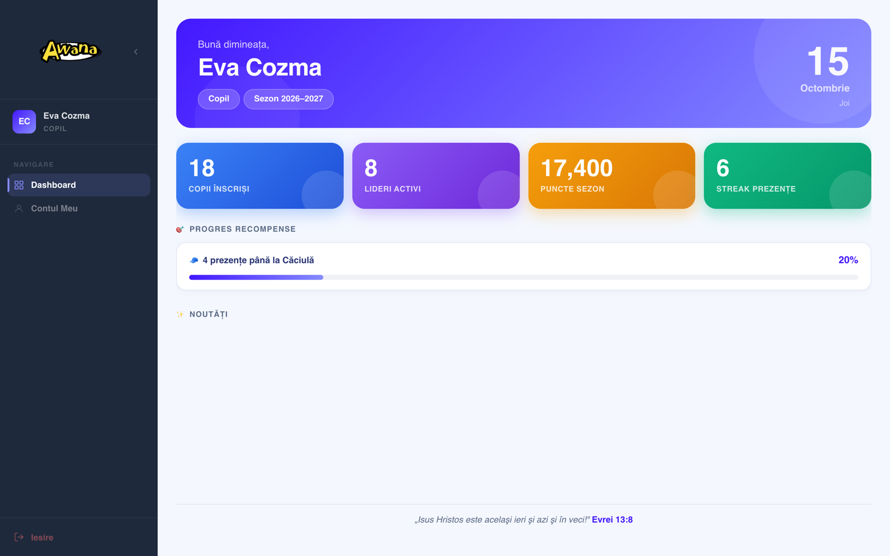

### Fair: new receipt (phone)
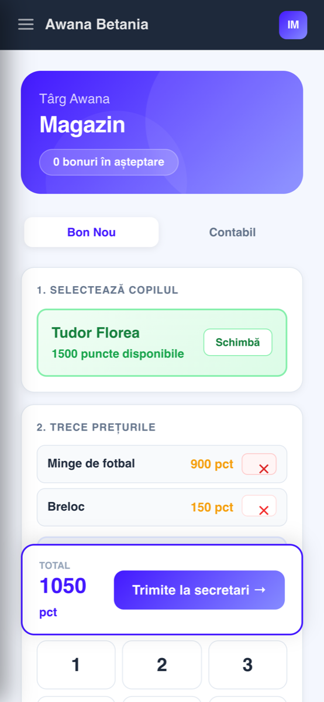

### Fair: accountant, after a card tap
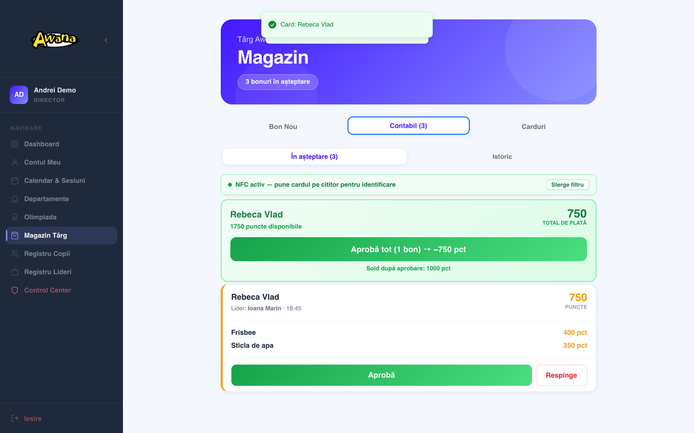

### Olimpiada: referee scoring
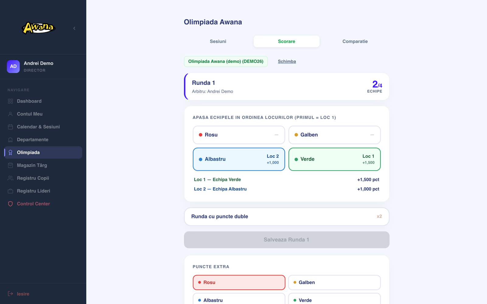

### Olimpiada: comparison and ranking
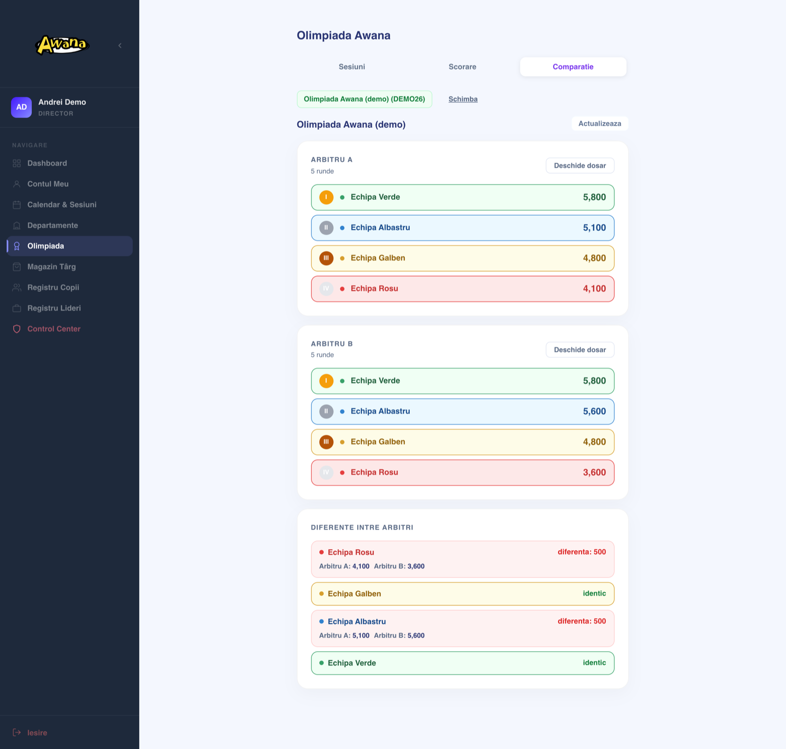

### Seasons
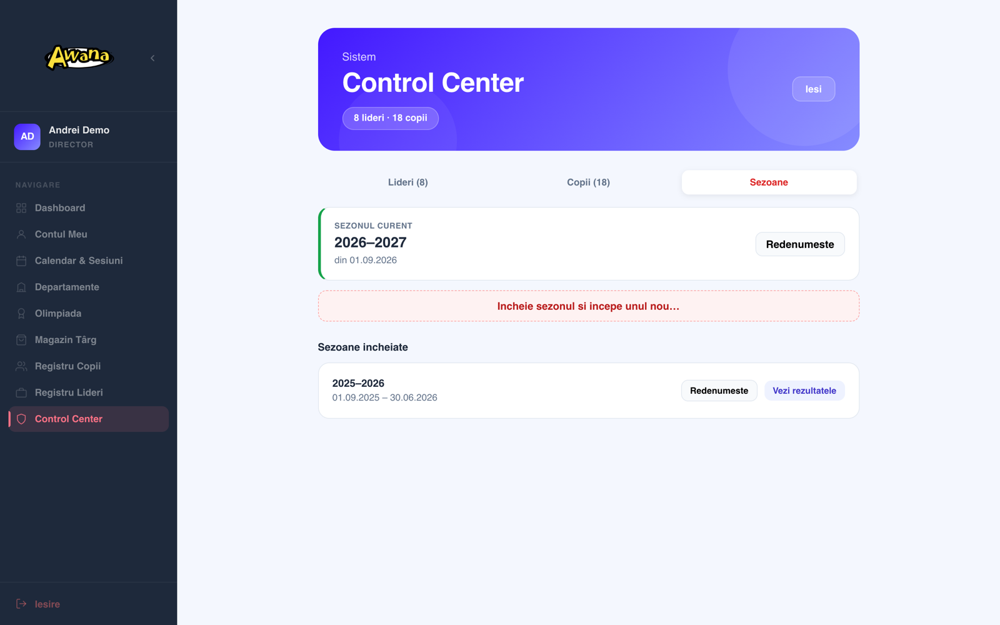

## Architecture

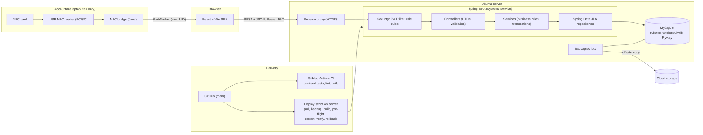

The backend follows Controller → Service → Repository. Controllers only handle HTTP: validated request records in, response records out, never JPA entities. Errors are returned as RFC 7807 problem responses, so bad input gives a 400 with a readable message instead of a 500.

In numbers (from the code): 19 JPA entities, 19 repositories, 21 REST controllers with 83 endpoints, 10 services, 11 Flyway migrations, about 20 React screens and components, and 85 automated backend tests.

## Data model

Simplified; field lists are shortened and contain no real data.

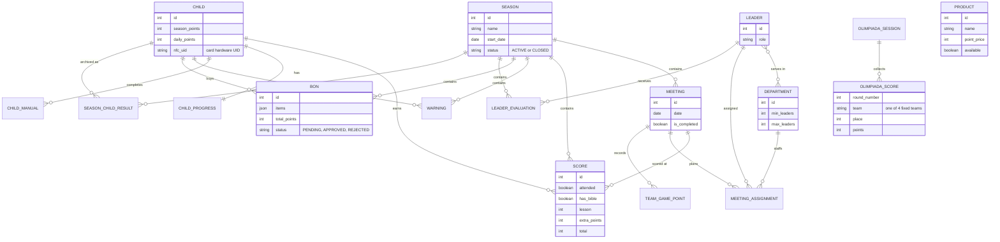

The Olimpiada tables are deliberately separate from the club data: a competition can never change a child's points.

## Engineering highlights

### 1. NFC cards that store nothing
The fair uses ordinary NFC cards, and nothing is written to them. Each card has a factory-unique hardware UID; the app maps that UID to a child, and the balance stays in the database. A lost card is replaced by linking a new one, and nothing can be "topped up" by rewriting a card. Browsers can't talk to a USB smart-card reader, so a small Java bridge runs on the accountant's laptop, polls the reader over PC/SC, reads the UID with a standard APDU command and pushes it to the open page over a local WebSocket. The page fills the field automatically and reconnects on its own if the bridge restarts.

### 2. Spending points safely under concurrency
At the fair several people approve receipts at the same time, and a double-click is common. The first version read the balance, subtracted and saved. In a test against a real MySQL instance, simultaneous approvals of the same receipt all succeeded: 8 out of 8. Now spending is a single conditional `UPDATE` that only succeeds if the balance is high enough, and every status change (pending → approved) is an `UPDATE ... WHERE status = 'PENDING'` whose affected row count is checked. A concurrency test runs this against MySQL 8 in Docker (Testcontainers) and checks that a receipt is approved once and a balance never goes negative.

### 3. Moving a live database to versioned migrations
The schema was originally created and changed by Hibernate at startup. To move to Flyway without touching production data, I wrote a baseline migration from the real schema and verified it by replaying every historical version of the entities and validating the result against the current code. Production adopts it as version 1 without running it. From then on the rules are: every schema change is a new migration, migrations are never edited, and changes are additive within a deploy so the previous version still runs on the new schema (needed for rollback). Hibernate only validates and refuses to start on a mismatch, and a test runs all migrations on MySQL 8 and checks them against the entities.

### 4. Deploys that check themselves
A deploy backs up the database, builds, then starts the new version once without the web server. That applies migrations and validates schema and configuration while the site is still served by the old version; if it fails, nothing changes. Only then is the service restarted, and the script waits for the health endpoint and checks that the version answering is the commit it just built. That last check exists because of a real incident: an earlier script started the app outside the service manager, and an orphaned old process kept serving the site for days while the service kept failing to start behind it. If the new version doesn't come up, the previous build is restored automatically.

### 5. Season rollover in one step
A new club year has to reset a lot (points, streaks, attendance, rewards, handbooks, leader ratings, pending receipts) while keeping people, accounts and cards, and the old year has to stay readable. The rollover takes a database backup first and refuses to start if the backup fails, then does everything in a single transaction: archives each child's results, closes the season and opens a new one. Season data is tagged with a season id instead of being deleted. Closing uses the same conditional-update pattern as above, so two directors clicking at once still create exactly one new season (covered by a MySQL concurrency test).

## Deployment

- The app is self-hosted on an Ubuntu server, behind a reverse proxy that terminates HTTPS. The Spring Boot app runs as a systemd service, which restarts it if it stops.
- Production configuration and secrets live only on the server, outside the repository, and are read at startup. The app refuses to start without them.
- Every push runs CI on GitHub Actions: backend tests (including MySQL 8 in Docker), frontend lint and build, and the NFC bridge build. Dependabot proposes dependency updates weekly.
- A deploy is one scripted step on the server that pulls `main`, backs up the database, builds, runs the pre-flight check, restarts the service, verifies health and the running commit, and rolls back automatically on failure.
- Database backups are compressed and written atomically, copied to off-site cloud storage, and only the most recent ones are kept on the server. They run before every deploy, before every new season, and on a daily timer. Restores are scripted too, and take a backup of the current state first.

## Tech stack

| Layer | Technology |
|---|---|
| Frontend | React 19, Vite, Google Identity Services (leader sign-in) |
| Backend | Java 17, Spring Boot 3.5, Spring Security with JWT, Bean Validation, JPA/Hibernate |
| Database | MySQL 8, Flyway migrations |
| NFC | Java `javax.smartcardio` (PC/SC), WebSocket bridge |
| Testing | JUnit 5, MockMvc, H2, Testcontainers (MySQL 8) |
| CI | GitHub Actions, Dependabot |
| Hosting | Ubuntu Linux, systemd, reverse proxy with HTTPS |
| Operations | Bash deploy, backup and restore scripts, systemd timer for daily backups |

## Roadmap

The major update I'm working on now is a rewrite of the backend into clear layers, done one area at a time, each in its own pull request with tests:

- **Done:** the fair (receipts, products, NFC cards), with DTOs, a service layer, proper error responses and concurrency-safe point spending; seasons; invite-only leader accounts with Google sign-in and director-issued password resets; a security review with role-based access on every endpoint; Flyway migrations, CI, safer deploys and automated backups.
- **Next:** the same treatment for scoring and meetings, then children/leaders/accounts, then the Olimpiada, then departments, teams, feedback, notifications and the dashboard. This replaces the remaining loosely typed request bodies with validated DTOs, so bad input always gets a clear 400.
- **Frontend:** URL-based navigation with React Router (back button and direct links), shared state instead of prop drilling, error boundaries instead of a blank screen on a crash, and live updates instead of polling on the teams screen.
- **Later:** TypeScript on the frontend.

## Author

**Raul Daniel Macovei** ([@raul-dan23](https://github.com/raul-dan23)) — full-stack development: design, backend, frontend, NFC bridge, server and deployment.
